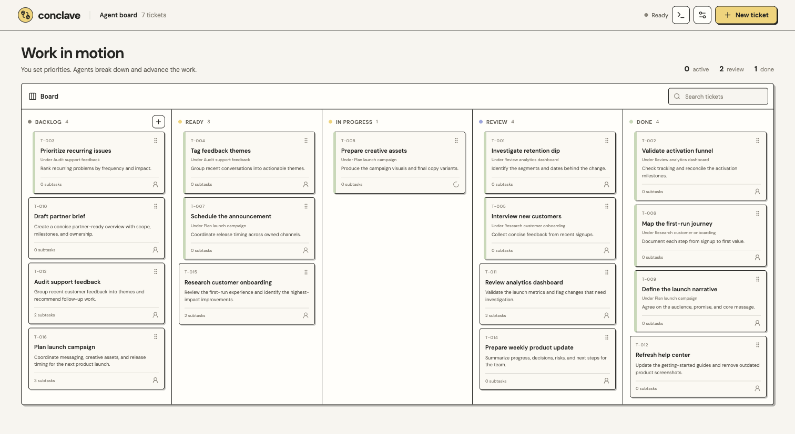
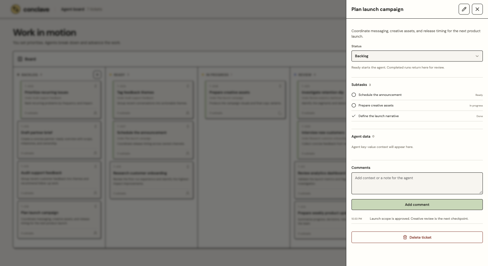
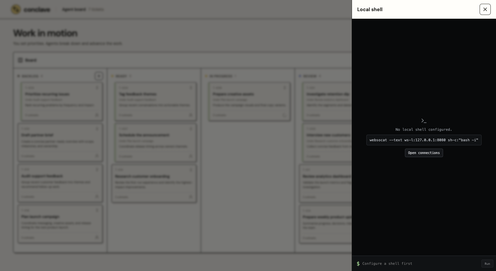
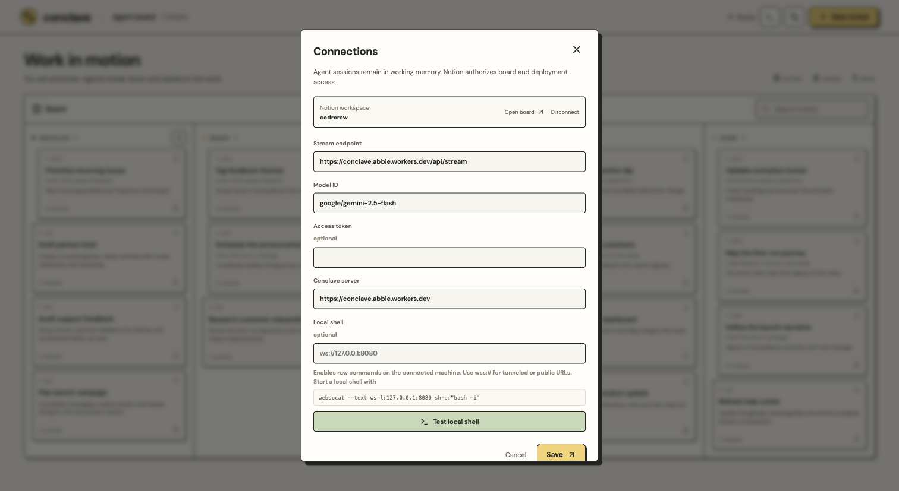

# Conclave

Conclave is a shared work board where you set priorities and an AI agent helps move the work forward. Tickets, subtasks, comments, agent context, and deployment progress stay together instead of being scattered across separate chats and tools.

[Open Conclave](https://theabbie.github.io/conclave/)



## How it works

1. Connect your Notion workspace. Conclave creates and maintains its board there, so the source of truth remains in an account you control.
2. Create a ticket with the outcome and context the agent needs.
3. Move the ticket to **Ready** when it can be picked up.
4. The agent reads the ticket and its comments, decides whether it can proceed, creates subtasks when useful, and records its work in the conversation.
5. Review the result and move the ticket to **Done**, or add a comment and send it back for another pass.

Every ticket and subtask is independently draggable between Backlog, Ready, In progress, Review, and Done. Comments that need a decision or response can be marked for attention and surfaced above the board.

## Ticket workspace

Open a ticket to see its full description, current status, subtasks, agent data, and conversation. Titles and descriptions remain editable as the work changes. Top-level tickets can be deleted from Backlog.



The agent can:

- read the assigned ticket, its comments, and any subtask on demand;
- create and update subtasks;
- add comments and request attention only when a person needs to respond;
- keep structured working data attached to the ticket;
- create, update, and deploy atomic API units;
- run commands through an optional local or tunneled shell;
- react to ticket, comment, and deployment events while a run is active.

## Optional local shell

Conclave can share one command stream between the agent and you. The terminal drawer shows commands, live output, exit status, duration, and whether the command came from the agent, a manual run, or a connection test.

Start a local shell bridge:

```sh
websocat --text ws-l:127.0.0.1:8080 sh-c:"bash -i"
```

Then enter `ws://127.0.0.1:8080` under **Connections → Local shell**. A complete `wss://` URL can be used for a tunnel or remote bridge. This grants raw command access to the connected machine; only connect a shell you trust and stop it when it is no longer needed.



## Connections

The connection panel keeps the LLM stream endpoint, model, Conclave server, and optional local shell in one place. Agent sessions are working memory; board and deployment records are persisted through Notion.



The hosted defaults point to Conclave's Cloudflare Worker and `google/gemini-2.5-flash`. An access token can be supplied when a compatible stream endpoint requires one.

## Persistence and authentication

- Board records are stored as individual Notion-backed ticket, comment, and deployment entities.
- The browser stores an encrypted Notion session token in `localStorage` under `conclave.notion.session`.
- LLM conversations remain working memory and are not restored as durable sessions.
- Local-shell history is held in memory for the current page session.
- Deployment source is preserved by the separate `conclave-workspace` Worker.

The storage boundary is deliberately isolated behind the board persistence interface, so Notion can later be replaced by another persistence adapter without changing agent tools or board behavior.

## Local development

### Requirements

- Node.js 24 or newer
- npm
- A modern browser
- Wrangler authentication for Worker development or deployment
- `websocat` only if local-shell access is needed

Install dependencies and start the client:

```sh
npm ci
npm run dev
```

Vite serves the app at `http://127.0.0.1:5173`. The production client uses relative asset paths and can be built for any static host:

```sh
npm run build
```

Run the test suite and type checks:

```sh
npm test
npm run typecheck
```

Run the Worker locally:

```sh
npm run server:dev
```

Useful scripts:

| Command                                             | Purpose                                                           |
| --------------------------------------------------- | ----------------------------------------------------------------- |
| `npm run dev`                                       | Start the Vite client                                             |
| `npm run build`                                     | Type-check and build the client                                   |
| `npm run pages:build`                               | Build and copy the static site into the ignored `docs/` directory |
| `npm test`                                          | Run all Vitest tests                                              |
| `npm run server:dev`                                | Run the main Worker locally                                       |
| `npm run server:deploy`                             | Deploy the main Conclave Worker                                   |
| `npm run release:prepare -- <file>`                 | Build a validated self-deployment release                         |
| `npm run release:publish -- stage <file> <receipt>` | Stage a release                                                   |
| `npm run release:publish -- activate <receipt>`     | Activate a staged release                                         |

### Worker configuration

The repository contains two Worker configurations:

- `wrangler.jsonc` deploys the main `conclave` Worker.
- `wrangler.workspace.jsonc` deploys the isolated `conclave-workspace` source and API workspace.

The main Worker expects these secrets in deployed environments:

```text
NOTION_CLIENT_ID
NOTION_CLIENT_SECRET
NOTION_SESSION_PRIVATE_KEY
CONCLAVE_DEPLOY_TOKEN
WORKSPACE_SOURCE_TOKEN
```

Cloudflare release authentication additionally requires either
`CLOUDFLARE_API_TOKEN`, or the `CLOUDFLARE_API_KEY` and
`CLOUDFLARE_AUTH_EMAIL` pair. A narrowly scoped API token is preferred.

Set secrets with Wrangler rather than committing them:

```sh
npx wrangler secret put NOTION_CLIENT_ID
```

Repeat that command for each secret and for the appropriate Worker
configuration. The Notion OAuth callback is:

```text
https://conclave.abbie.workers.dev/api/integrations/notion/callback
```

Deploy the workspace before the main Worker:

```sh
npx wrangler deploy --config wrangler.workspace.jsonc
npm run server:deploy
```

GitHub Pages is built and deployed by `.github/workflows/pages.yml`; generated `docs/` content is intentionally not committed.

## Architecture

- `src/board/` owns immutable board state, hierarchy, validation, events, and persistence deltas.
- `src/notion/` connects the browser to Notion-backed persistence.
- `src/agent/` hosts the Pi agent loop, tool definitions, event steering, and streaming transport.
- `src/local-shell/` provides the shared serialized command hub and WebSocket client.
- `src/deploy/` compiles and releases atomic API units from the browser.
- `server/notion.ts` implements OAuth, encrypted sessions, and board records.
- `server/releases.ts` validates, stages, and activates Cloudflare Worker versions.
- `server/worker.ts` exposes the LLM stream, board, source, release, and generated API routes.

The browser talks to the main Worker. Source and deployment operations are delegated to `conclave-workspace`, keeping deployment credentials and editable source outside the static client.

## Self-deployment

Conclave's release protocol does not require Git at runtime:

1. Fetch the current workspace source from `GET /api/source`.
2. Add or update an atomic API unit.
3. Compile the Worker in the browser and run pre-deployment checks.
4. Stage the validated artifact with `POST /api/releases`.
5. Activate its signed receipt with `POST /api/releases/activate`.

Cloudflare receives the compiled Worker while the full editable source snapshot travels as a separate text module. This keeps source fetchable for the next change without requiring R2.

## License

This repository is currently private and does not declare an open-source license.
